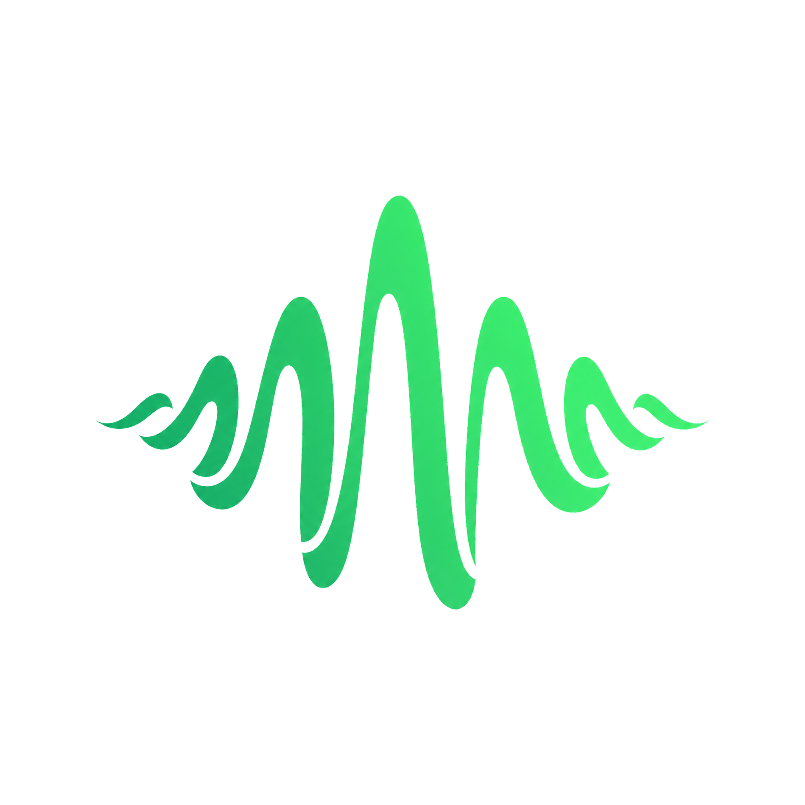

<p align="center">
  
</p>

<h1 align="center">AuralFlow</h1>

<p align="center">A music player for Windows and Android, with online search, a local library, synchronized lyrics, and WebDAV sync.</p>

<p align="center">
  <a href="README.md">English</a> · <a href="README.zh-CN.md">简体中文</a>
</p>

<p align="center">
  <a href="https://github.com/0nini00/auralflow/releases/latest">Download</a> ·
  <a href="#quick-start">Quick start</a> ·
  <a href="https://github.com/0nini00/auralflow/issues">Report an issue</a> ·
  <a href="#acknowledgments">Acknowledgments</a>
</p>

## Features

AuralFlow brings online music and local audio into one library. The desktop app uses Tauri and React; the Android app uses React Native. Both share music models, lyric parsers, source protocols, and synchronization rules through `@lx/core`.

| Area | Windows | Android |
| --- | --- | --- |
| Search and playback | NetEase / QQ Music search, custom sources, playback queue, repeat modes, speed control, and sleep timer | Same core features, with background playback and notification controls |
| Music library | Local folder scanning, metadata editing, playlists, favorites, history, downloads, and offline playback | MediaStore scanning and file import, metadata editing, playlists, favorites, history, downloads, and offline playback |
| Lyrics | Scrolling lyrics, word-timed rendering, translations, and a separate floating lyric window | Line highlighting, translations, lyric offset adjustment, and a floating lyric overlay |
| Player backgrounds | Animated smoke adapted from MyGo Music, plus a cover background | Soft bloom animation based on the theme accent color; colors do not change with album artwork |
| System integration | System tray, media controls, and floating lyrics | System media controls and a floating-lyrics toggle in the expanded media card |
| Cross-device data | WebDAV sync for playlists, favorites, history, and custom source scripts | The same sync format for exchanging data with the desktop app |

Online features also include recommendations, Private FM, charts, comments, and MV playback. Playback and available quality depend on the source, track, and account access.

Local tracks use their own embedded lyrics or same-directory `.lrc` files. Artwork comes from embedded tags or local companion images. Missing local lyrics are not searched for online.

## Download

Get installation files from [GitHub Releases](https://github.com/0nini00/auralflow/releases/latest).

| Platform | Release asset | Notes |
| --- | --- | --- |
| Windows x64 | `*-windows-x64-setup.exe` | Installer |
| Windows x64 | `*-windows-x64-portable.exe` | Standalone executable; application data remains in the system user directory |
| Android ARM64 | `*-arm64-v8a.apk` | 64-bit ARM build |
| Android ARM32 | `*-armeabi-v7a.apk` | 32-bit ARM build |

Android builds require Android 7.0 / API 24 or later. Current release packages target Windows and Android; no macOS, Linux, or iOS installer is provided.

Releases also include a source archive and SHA256 checksums. Windows updater signatures and manifests are included alongside the installer.

## Quick start

1. Install the package for your device and open AuralFlow.
2. Try a local track: on Windows, open **Local Music → Scan Folder**; on Android, use **Scan Local** or **Add Files** in the library's local music section. Grant file or audio access when requested.
3. Select a track to play it, then open the full player to view lyrics and playback controls.

For online music, search by title or artist. Custom source scripts can be imported and enabled in **Settings → Sources**; account-dependent features use the account settings.

To use floating lyrics on Android, enable them in the player and grant overlay permission. The expanded system media card can then toggle the overlay from the background. Button placement and visibility depend on the phone's system UI.

For cross-device data, enter your WebDAV server details in the sync settings on both devices. WebDAV synchronizes library records and custom sources; it does not upload your local audio files.

## Development

The commands below run from the repository root. Release scripts use PowerShell 7, and the desktop native code currently depends on Windows APIs.

### Requirements

| Tool | Configuration |
| --- | --- |
| Node.js | Node.js 24 is used for local development; CI also covers the 22 series |
| pnpm | `11.5.1`, pinned by the root `packageManager` field |
| Windows desktop toolchain | Rust stable, MSVC C++ build tools, and WebView2; see [Tauri prerequisites](https://v2.tauri.app/start/prerequisites/) |
| Android toolchain | JDK 17, Android SDK 36, Build Tools 36.0.0, NDK 27.1.12297006, and CMake 3.22.1 |

Install the workspace dependencies:

```powershell
git clone https://github.com/0nini00/auralflow.git
cd auralflow
pnpm install --frozen-lockfile
```

The mobile `postinstall` applies native dependency patches and prepares the custom-source runtime assets. Keep lifecycle scripts enabled; the patched interfaces are part of the application's build contract.

### Run locally

```powershell
pnpm desktop:tauri:dev
```

This starts the desktop app with its Rust backend. `pnpm desktop:dev` runs the frontend alone and is intended for UI work.

For Android, connect a device with USB debugging enabled or start an emulator, then use two terminals:

```powershell
# Terminal 1
pnpm mobile:start
```

```powershell
# Terminal 2
pnpm mobile:android
```

### Checks

```powershell
pnpm check:all
pnpm test:core
pnpm test:desktop
pnpm mobile:test
pnpm test:rust
```

The native Android tag tests use JDK 17, FFmpeg, and jaudiotagger 3.0.1. They read jaudiotagger from the Gradle cache, or from `JAUDIOTAGGER_JAR`. Rust tests run on Windows. The complete validation setup is in [CI](.github/workflows/ci.yml).

### Build packages

```powershell
# Android debug APK
pnpm mobile:build:debug

# Signed Android releases, one ABI per invocation
.\apps\mobile\build-release-arm64.ps1 -Abi arm64-v8a
.\apps\mobile\build-release-arm64.ps1 -Abi armeabi-v7a

# Windows installer, executable, and updater manifests
.\desktop\build-release.ps1
```

Android release builds read signing configuration from an external directory selected by `AURALFLOW_KEYSTORE_DIR`. Windows release builds require updater signing material configured for [the release script](desktop/build-release.ps1). Signing credentials are not included in this repository.

The release scripts place distributable files in `dist/`. The Windows script uploads only when explicitly run with `-Publish`; its release tag must match the build's source commit.

## Repository

```text
auralflow/
├── apps/mobile/                 React Native app and Android native modules
├── desktop/                     React frontend and Tauri application
│   ├── src-tauri/               Rust native backend
│   ├── packages/tauri-bridge/   Desktop IPC bridge
│   └── third-party/mygo-music/  Smoke background attribution and license
├── packages/core/               Shared models, parsers, source and sync logic
├── docs/                        Design notes and troubleshooting documents
└── .github/workflows/ci.yml     Automated checks and Android debug build
```

For implementation details, see the [mobile app guide](apps/mobile/README.md), [shared-core boundaries](packages/core/SPEC.md), [desktop native-layer boundaries](desktop/src-tauri/SPEC.md), and [Android native-layer boundaries](apps/mobile/android/SPEC.md).

## Feedback and contributions

Use [Issues](https://github.com/0nini00/auralflow/issues) for bug reports and feature requests. For a bug, include the app version, device and OS version, reproduction steps, and the error message. Remove account cookies, passwords, and private server details from logs before attaching them.

Changes should include checks for the affected behavior. For native Android changes or dependency patches, compile the Android project as well as running the JavaScript tests.

## Acknowledgments

Thanks to the authors and maintainers of the projects below. Their contributions range from code adapted into AuralFlow to protocols, frameworks, and libraries used by the application.

### Adapted code and protocol references

- **[MyGo Music](https://github.com/egoist/mygo-music)** by egoist: the desktop smoke background adapts the shader, color generation, and motion behavior from `internal/app/backdrop.go` at commit `a717245f18e773f27ffe9ee08b330dd101218515`. The port uses WebGL GLSL and does not currently use bass input. See the [adaptation notice](desktop/third-party/mygo-music/NOTICE.md) and the preserved [AGPL-3.0 license](desktop/third-party/mygo-music/LICENSE).
- **[LX Music Desktop](https://github.com/lyswhut/lx-music-desktop)** by lyswhut and its contributors: a reference for the custom-source script protocol, music metadata conventions, and lyric parsing behavior.

### Frameworks and libraries

| Project | Used for |
| --- | --- |
| [Tauri](https://github.com/tauri-apps/tauri), [React](https://github.com/react/react), [React Native](https://github.com/react/react-native) | Desktop shell, UI, and Android application framework |
| [Vite](https://github.com/vitejs/vite), [TypeScript](https://github.com/microsoft/TypeScript), [pnpm](https://github.com/pnpm/pnpm) | Frontend builds, type checking, and workspace management |
| [React Native Track Player](https://github.com/doublesymmetry/react-native-track-player), [KotlinAudio](https://github.com/doublesymmetry/KotlinAudio), [ExoPlayer](https://github.com/google/ExoPlayer) | Android audio playback, background service, and media-session controls |
| [React Native Video](https://github.com/TheWidlarzGroup/react-native-video) | MV and comment-audio playback |
| [Lofty](https://github.com/Serial-ATA/lofty-rs), [jaudiotagger](https://www.jthink.net/jaudiotagger/) | Local audio metadata, embedded lyrics, and artwork |
| [Zustand](https://github.com/pmndrs/zustand), [React Navigation](https://github.com/react-navigation/react-navigation) | Application state and mobile navigation |
| [Lucide](https://github.com/lucide-icons/lucide) | Desktop and mobile icons |
| [Reanimated / Worklets](https://github.com/software-mansion/react-native-reanimated), [Gesture Handler](https://github.com/software-mansion/react-native-gesture-handler) | Mobile animations and gestures |
| [React Native WebView](https://github.com/react-native-webview/react-native-webview), [Endo / SES](https://github.com/endojs/endo) | Mobile custom-source runtime and JavaScript execution compartments |
| [CryptoJS](https://github.com/brix/crypto-js), [node-forge](https://github.com/digitalbazaar/forge), [pako](https://github.com/nodeca/pako) | Protocol cryptography and compressed lyric data |
| [OpenCC JS](https://github.com/nk2028/opencc-js) | Simplified and traditional Chinese lyric conversion |
| [AsyncStorage](https://github.com/react-native-async-storage/async-storage), [React Native FS](https://github.com/itinance/react-native-fs), [FastImage](https://github.com/dream-horizon-org/react-native-fast-image) | Mobile persistence, file access, and image loading |

The built-in music API adapter also uses the [GD Studio Music API](https://music-api.gdstudio.xyz/).

This list highlights the main dependencies. The complete JavaScript dependency graph is recorded in [pnpm-lock.yaml](pnpm-lock.yaml), and the desktop Rust dependencies in [Cargo.lock](desktop/src-tauri/Cargo.lock). Thanks also to contributors who report issues, test packages, and improve these projects.

## License information

The repository does not currently contain a project-wide `LICENSE` file. This README does not assign a blanket license to the project.

The MyGo-derived smoke implementation is marked `AGPL-3.0-only`, with its source attribution and license preserved in [desktop/third-party/mygo-music](desktop/third-party/mygo-music/). Other dependencies retain their upstream licenses; the mobile runtime also includes the [node-forge](apps/mobile/android/app/src/main/assets/lx_bridge/forge.LICENSE.txt) and [SES](apps/mobile/android/app/src/main/assets/lx_bridge/ses.LICENSE.txt) license texts.
