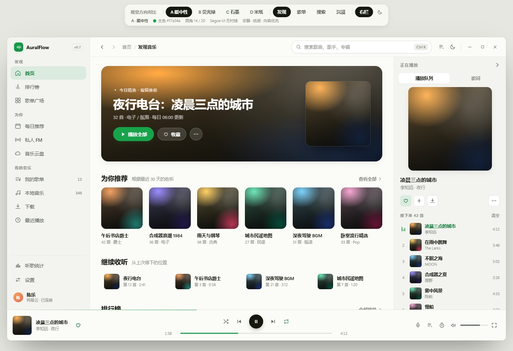
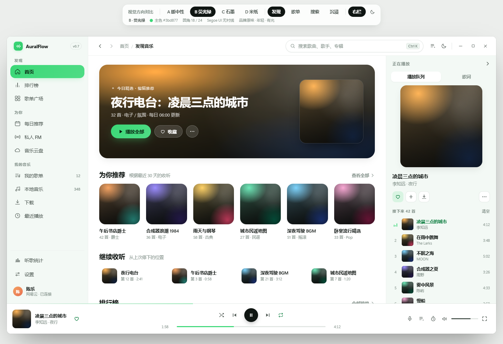
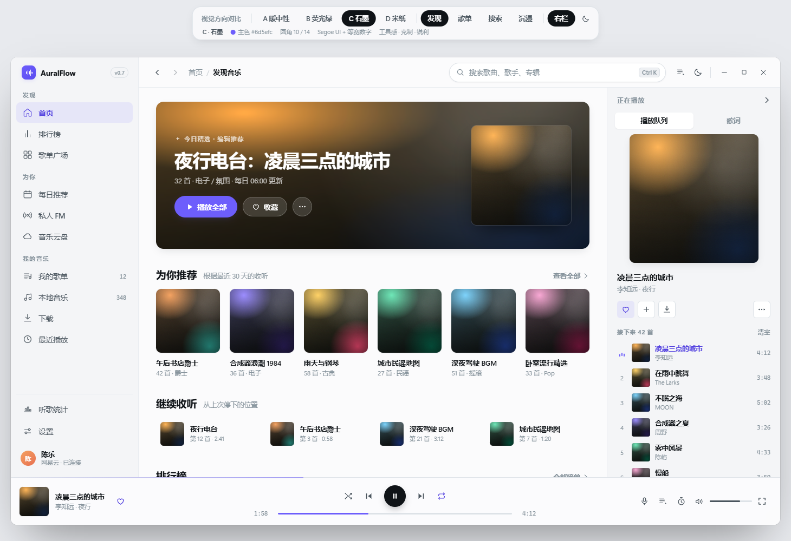
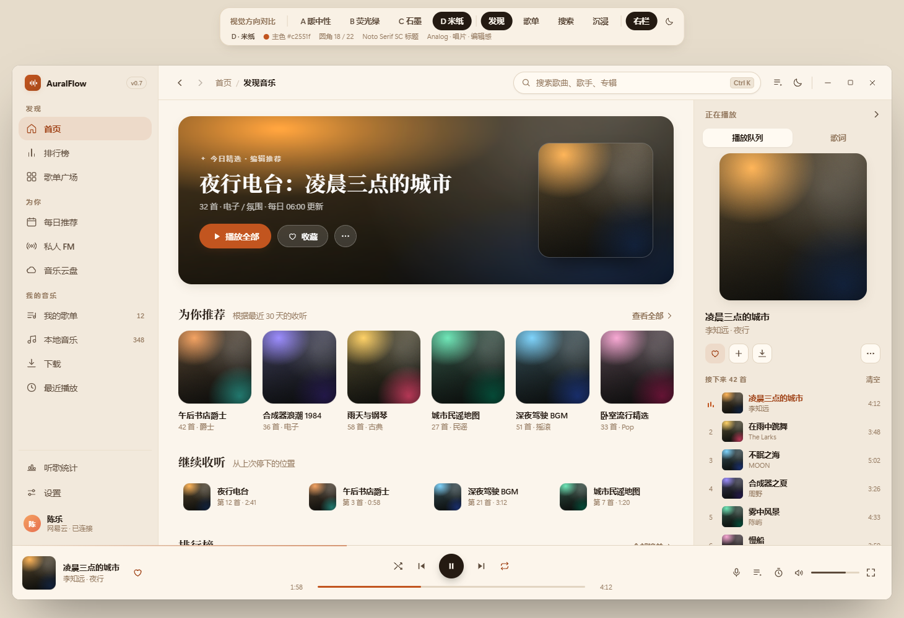

# 视觉方向对比 · 4 选 1

> 2026-10-21 · 配套原型：[`directions.html`](./directions.html)（顶部切 A/B/C/D，右上角切明暗）
>
> **前提**：布局已确认——56px 顶栏（含标题栏）、分组侧栏、全宽 88px 播放条、可收起「正在播放」右栏。
> 四个方向**共用同一套结构与尺寸**，只换色彩、圆角、字体和质感，所以可以直接对比"气质"，不用重新理解版式。

---

## A · 暖中性 Quiet Paper

| | |
|---|---|
| 主色 | `#17a34a` 深交互绿（品牌绿 `#3bd877` 只留在 logo 与封面氛围光） |
| 画布 | `#f3f3ef` 暖纸灰 + 纯白卡片 |
| 圆角 | 14 / 20 |
| 标题字 | Segoe UI（无衬线） |
| 关键词 | 安静、耐看、内容优先 |

**为什么这样定**：现在的中性色 `#eef2ed` 本身带绿调，与强调色同色系，绿色跳不出来。改成暖中性后，绿色只出现在"可以点的东西"上，一眼就知道哪里能点。

**适合**：把播放器当长期背景用、一天开八小时的人。**代价**：第一眼不抓人，品牌记忆最弱。

---

## B · 荧光绿 Neon Pop

| | |
|---|---|
| 主色 | `#3bd877` 品牌原色（保留） |
| 画布 | `#f3f9f5` 薄荷调 + 纯白卡片 |
| 圆角 | 18 / 24（更圆） |
| 标题字 | Segoe UI（无衬线） |
| 关键词 | 年轻、有光、品牌一致 |

**为什么这样定**：不换品牌，只换骨架。选中态用实心品牌绿胶囊 + 主按钮品牌渐变外发光，让"绿"成为记忆点，而不是背景色。

**适合**：想让用户一眼认出"这还是 AuralFlow"。**代价**：实心绿选中态抢视线（可与主按钮争夺注意力，实施时可降为浅底 + 左侧竖条）；浅色下大面积荧光绿容易显廉价，必须克制。

---

## C · 石墨 Studio Graphite

| | |
|---|---|
| 主色 | `#6d5efc` 电光紫 |
| 画布 | `#f4f5f7` 冷灰石墨 |
| 圆角 | 10 / 14（锐利） |
| 标题字 | Segoe UI + 等宽数字（Cascadia Mono） |
| 关键词 | 工具感、精确、克制 |

**为什么这样定**：把播放器当"音频工具"而不是"内容杂志"。圆角收紧、数字换等宽、留白更规整，读列表时对齐更硬。

**适合**：曲库大、天天用列表和队列的人。**代价**：紫色与"音乐"的关联弱；整体偏冷，缺一点温度；和现有品牌绿是彻底换血。

---

## D · 米纸 Analog Paper

| | |
|---|---|
| 主色 | `#c2551f` 焦糖橙 |
| 画布 | `#f2e9dc` 米纸 + `#fffaf2` 卡片 |
| 圆角 | 18 / 22 |
| 标题字 | **Noto Serif SC**（衬线），正文仍是无衬线 |
| 关键词 | Analog、唱片店、编辑感 |

**为什么这样定**：播放器最动人的部分是封面、歌名和歌单文案。衬线标题 + 米纸底把页面推向"印刷品"，封面放上去更像唱片内页。颗粒（noise）比其他方向更重一点。

**适合**：在意歌单叙事、封面墙、文字气质的人。**代价**：衬线只适合大字号，小字必须留无衬线（方案里已如此）；暖底对封面色调挑剔，冷色封面会显脏。

---

## 横向对比

| 维度 | A 暖中性 | B 荧光绿 | C 石墨 | D 米纸 |
|---|---|---|---|---|
| 第一眼抓人 | 中 | **高** | 中高 | **高** |
| 长时间耐看 | **高** | 中 | 高 | 中高 |
| 品牌一致性 | 中（换了绿） | **高**（原色） | 低（换紫） | 低（换橙） |
| 与现有代码的落差 | 中 | **小** | 大 | 大 |
| 封面适配性 | 高 | 高 | 高 | 中（暖底挑图） |
| 实施成本 | 中 | **小**（色值基本不动） | 中 | 大（要引衬线字体栈） |
| 一句话 | 安静的好学生 | 记忆点最强 | 最像专业工具 | 最有味道 |

---

## 我的建议

- **只能选一个**：选 **A**。它是最不容易后悔的一版——不抢内容、不挑封面、暗色下最稳。
- **想要记忆点**：选 **D**。衬线标题是四个方案里唯一"别人没有"的东西，代价是字体与暖底的适配成本。
- **不想让用户觉得换了个 App**：选 **B**，色值几乎不用动，只换骨架。
- **两个混合**（也完全可行，我已验证过组合效果）：
  - **A + 衬线标题**：A 的暖中性骨架，只把 h1/h2 换成 Noto Serif SC —— 比纯 A 更有味道，比 D 更好适配封面。
  - **A + B 的选中态**：暖中性打底，侧栏选中用品牌绿实心胶囊 —— 品牌感回来，又不至于满屏荧光。

看完告诉我选哪个（或要哪种混合），我就按 `PROPOSAL.md` §9 的阶段 0 开始改代码。
